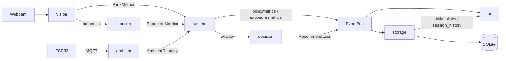

# Arquitectura de Blinky

## Módulos

La fuente de datos se elige en `runtime.source`:

- `ui`: `AppState` simula dentro de la UI.
- `simulated`: `runtime/simulated.py` publica eventos sin hardware.
- `real`: `runtime/pipeline.py` conecta cámara, visión, exposición y motor.
  Es la fuente por defecto. La calibración empieza con el primer rostro y la
  detección queda suspendida hasta tener el umbral personal.

## Responsabilidades

| Carpeta | Responsabilidad | No debe hacer |
| --- | --- | --- |
| `contracts` | Tópicos, QoS, retain, LWT y JSON Schema | Contener código |
| `core` | Modelos, EventBus, settings | Tocar Tk o cámara |
| `vision` | Captura, landmarks, EAR, calibración, parpadeo | Actualizar widgets |
| `exposure` | Presencia, tiempo de sesión, pausas | Reglas de alerta |
| `ambient` | MQTT y validación del contrato | Abrir ventanas |
| `decision` | Reglas y recomendaciones | Leer cámara o MQTT directo |
| `runtime` | Unir fuentes, decidir y publicar | Dibujar o hablar SQL |
| `storage` | Esquema SQLite y series | Reglas de negocio |
| `ui` | Vistas, widgets, tema | Lógica de negocio |

## Temas del EventBus

- `blink.metrics`: `BlinkMetrics` calculado por visión o simulación (tasa,
  duración, PERCLOS y cierres largos).
- `blink.event`: `BlinkEvent` puntual (`blink` o `long_closure`).
- `vision.status`: `VisionStatus` con backend, rostro, calibración y umbral.
- `vision.landmarks`: `FaceOverlay` con puntos normalizados para dibujar el
  contorno facial, los ojos y los iris sobre el video (sin transportar frames).
- `exposure.metrics`: `ExposureMetrics` con sesión y pausas.
- `exposure.break`: `BreakEvent` (`started` / `finished`) al validar una pausa
  por ausencia prolongada; reinicia el contador continuo y alimenta el historial.
- `ambient.reading`: `AmbientReading` validado por MQTT o simulación.
- `ambient.status`: `"online"` / `"offline"` del LWT.
- `decision.recommendation`: `Recommendation` emitida por el motor.
- `tick`, `monitoring`, `camera`: eventos internos de la UI.

### Reglas ambientales

`decision/rules.py` tiene una regla por variable ambiental (`ambient_light`,
`ambient_temperature`, `ambient_humidity`) y una combinada
(`combined_blink_light`) para el caso «poco parpadeo + mala luz». Cada regla
devuelve una `Recommendation` con id propio (`light-*`, `temperature-*`,
`humidity-*`, `blink-light`), así el motor aplica el cooldown por aviso y la UI
puede marcarlos como hechos de forma independiente. Ninguna regla emite nada si
no hay `AmbientReading`: el panel muestra «Sin datos» en vez de un valor falso.

Los eventos pueden originarse en hilos distintos (paho, runtime). `AppState`
los encola y `MainWindow` los consume en el hilo de Tk cada 100 ms.

## Persistencia

`storage/database.py` crea `app/blinky.db` con:

- `sessions`, `blink_samples`, `ambient_samples`, `exposure_samples`,
  `recommendations`.
- Vistas `v_daily_blinks` y `v_daily_ambient` para estadísticas.

`storage/repository.py` es la única puerta de entrada: guarda eventos y
devuelve series listas para la UI o para exportar informes. `daily_blinks()`
alimenta el gráfico de la pestaña Estadísticas; `session_history()` lista la
sesión actual y las anteriores con parpadeos, pausas y alertas por sesión, sin
que la UI escriba SQL.

## Contrato MQTT

`contracts/topics.md` es la fuente de verdad. Resumen:

| Tópico | Dirección | QoS | Retain |
| --- | --- | --- | --- |
| `fatiga/ambient` | ESP32 -> app | 0 | false |
| `fatiga/ambient/status` | ESP32 -> app | 1 | true |
| `fatiga/blink` | app -> ESP32 | 0 | false (reservado) |
| `fatiga/test` | herramientas | 0 | false |

El ESP32 registra LWT `offline` en `fatiga/ambient/status`; al conectar publica
`online` retenido. La app descarta payloads que no cumplan
`contracts/ambient.schema.json`.

## EDT

1. EDT 1.1 - Estructura, configuración y contrato MQTT.
2. EDT 1.2 - Interfaz de monitoreo.
3. EDT 1.3 - Visión: cámara, landmarks, EAR y parpadeo.
4. EDT 1.4 - Exposición: presencia y pausas.
5. EDT 1.5 - Sensado ambiental ESP32 (BH1750 + SHT31) + MQTT.
6. EDT 1.6 - Motor de reglas y recomendaciones.
7. EDT 1.7 - Runtime, almacenamiento, pruebas y documentación.
