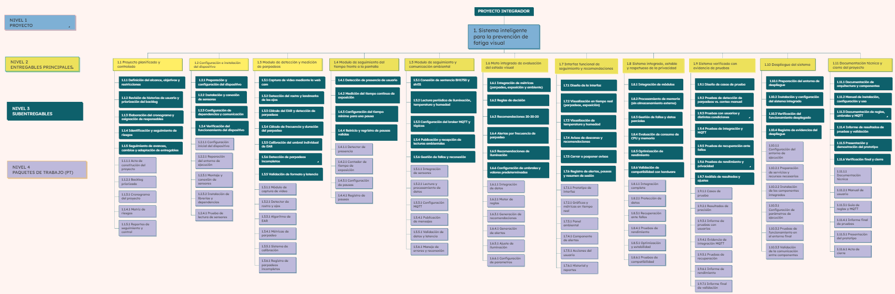

# ESTRUCTURA DE DESGLOSE DE TRABAJO (EDT / WBS)
## Sistema inteligente para la prevención de fatiga visual

## Jerarquía del EDT

- **1.0 Sistema inteligente para la prevención de fatiga visual**
  - **1.1 Gestión del proyecto**
    - 1.1.1 Documentos de inicio y planificación
      - 1.1.1.1 Acta de constitución del proyecto
      - 1.1.1.2 EDT y diccionario del EDT
      - 1.1.1.3 Cronograma del proyecto
      - 1.1.1.4 Presupuesto del proyecto
    - 1.1.2 Seguimiento y control
      - 1.1.2.1 Actas de reunión del equipo
      - 1.1.2.2 Reportes de avance
      - 1.1.2.3 Registro de riesgos y cambios
  - **1.2 Nodo IoT ambiental (ESP32)**
    - 1.2.1 Hardware del nodo
      - 1.2.1.1 Nodo ESP32 con sensores BH1750 y SHT31 montado
    - 1.2.2 Firmware del nodo
      - 1.2.2.1 Firmware de lectura de variables ambientales
      - 1.2.2.2 Firmware de publicación MQTT sobre Wi-Fi
    - 1.2.3 Verificación del nodo
      - 1.2.3.1 Registro de lecturas verificadas de los sensores
  - **1.3 Comunicación MQTT en el PC**
    - 1.3.1 Broker MQTT
      - 1.3.1.1 Broker MQTT configurado con tópicos
    - 1.3.2 Receptor de datos ambientales
      - 1.3.2.1 Módulo receptor de datos ambientales
      - 1.3.2.2 Mecanismo de reconexión y manejo de datos faltantes
  - **1.4 Módulo de monitoreo de parpadeo**
    - 1.4.1 Captura de video
      - 1.4.1.1 Módulo de captura de la cámara del PC
    - 1.4.2 Detección facial
      - 1.4.2.1 Detector de rostro y puntos de los ojos
    - 1.4.3 Medición del parpadeo
      - 1.4.3.1 Algoritmo de EAR y detección de parpadeos
      - 1.4.3.2 Calibración del umbral de EAR
      - 1.4.3.3 Métricas de parpadeo
  - **1.5 Módulo de tiempo de exposición a pantalla**
    - 1.5.1 Medición del tiempo
      - 1.5.1.1 Contador de tiempo continuo frente a la pantalla
    - 1.5.2 Gestión de pausas
      - 1.5.2.1 Registro de pausas con reinicio del contador
  - **1.6 Motor de decisión**
    - 1.6.1 Lógica de decisión
      - 1.6.1.1 Conjunto de reglas y umbrales
      - 1.6.1.2 Módulo del motor de decisión
    - 1.6.2 Recomendaciones
      - 1.6.2.1 Catálogo de recomendaciones preventivas
  - **1.7 Dashboard de alertas preventivas**
    - 1.7.1 Diseño de interfaz
      - 1.7.1.1 Prototipo de la interfaz
    - 1.7.2 Visualización de métricas
      - 1.7.2.1 Panel de parpadeo y tiempo de exposición
      - 1.7.2.2 Panel ambiental
    - 1.7.3 Alertas
      - 1.7.3.1 Componente de alertas y recomendaciones
  - **1.8 Sistema integrado**
    - 1.8.1 Integración de módulos
      - 1.8.1.1 Aplicación integrada
    - 1.8.2 Optimización
      - 1.8.2.1 Ajustes de rendimiento aplicados
  - **1.9 Pruebas y validación**
    - 1.9.1 Plan de pruebas
      - 1.9.1.1 Casos de prueba
    - 1.9.2 Pruebas por criterio de éxito
      - 1.9.2.1 Informe de exactitud de parpadeos
      - 1.9.2.2 Informe de latencia MQTT
      - 1.9.2.3 Informe de coherencia del motor de decisión
      - 1.9.2.4 Informe de tiempo de despliegue de alertas
    - 1.9.3 Pruebas del sistema
      - 1.9.3.1 Informe de pruebas de usabilidad con usuarios
      - 1.9.3.2 Informe de rendimiento y privacidad
  - **1.10 Cierre y presentación**
    - 1.10.1 Entregables finales
      - 1.10.1.1 Informe final del proyecto
      - 1.10.1.2 Código fuente en repositorio
    - 1.10.2 Presentación
      - 1.10.2.1 Demostración en vivo del prototipo
    - 1.10.3 Cierre administrativo
      - 1.10.3.1 Acta de cierre

## Diagrama del EDT

Link para ver mejor: https://www.mindomo.com/mindmap/e885309891254d5a9b609da6db271776

## Diccionario del EDT

| Código | Paquete de trabajo | Descripción |
| :--- | :--- | :--- |
| 1.1.1.1 | Acta de constitución del proyecto | Documento aprobado con objetivos, alcance, interesados, riesgos, hitos, presupuesto y firmas. |
| 1.1.1.2 | EDT y diccionario del EDT | Estructura de desglose de trabajo con codificación jerárquica y descripción de cada paquete de trabajo. |
| 1.1.1.3 | Cronograma del proyecto | Calendario de entregables entre el 26 oct y el 10 dic de 2026, con responsables asignados. |
| 1.1.1.4 | Presupuesto del proyecto | Estimación de costos de hardware, infraestructura y horas de desarrollo. |
| 1.1.2.1 | Actas de reunión del equipo | Registro de acuerdos, decisiones y pendientes de las reuniones del equipo y con el docente. |
| 1.1.2.2 | Reportes de avance | Informes periódicos del avance frente al cronograma y a los hitos del Acta. |
| 1.1.2.3 | Registro de riesgos y cambios | Matriz de riesgos actualizada y bitácora de cambios aprobados al alcance. |
| 1.2.1.1 | Nodo ESP32 con sensores BH1750 y SHT31 montado | ESP32 con los sensores de luz, temperatura y humedad cableados por I2C y alimentado por USB. |
| 1.2.2.1 | Firmware de lectura de variables ambientales | Programa del ESP32 que lee luxes, temperatura (°C) y humedad relativa (%) de forma periódica. |
| 1.2.2.2 | Firmware de publicación MQTT sobre Wi-Fi | Programa del ESP32 que se conecta a la red Wi-Fi y publica las lecturas en los tópicos MQTT definidos. |
| 1.2.3.1 | Registro de lecturas verificadas de los sensores | Evidencia de que los valores de los sensores son coherentes con una referencia o con valores esperados. |
| 1.3.1.1 | Broker MQTT configurado con tópicos | Mosquitto instalado en el PC, con los tópicos de luz, temperatura y humedad definidos. |
| 1.3.2.1 | Módulo receptor de datos ambientales | Cliente MQTT del PC que recibe y entrega las lecturas al motor de decisión. |
| 1.3.2.2 | Mecanismo de reconexión y manejo de datos faltantes | Lógica que reconecta ante caídas de Wi-Fi o del broker y avisa cuando no llegan datos. |
| 1.4.1.1 | Módulo de captura de la cámara del PC | Componente que obtiene los cuadros de la cámara integrada y los procesa solo en memoria. |
| 1.4.2.1 | Detector de rostro y puntos de los ojos | Detector basado en MediaPipe que ubica el rostro y los puntos de referencia de ambos ojos. |
| 1.4.3.1 | Algoritmo de EAR y detección de parpadeos | Cálculo del Eye Aspect Ratio por cuadro y detección de cada parpadeo según el umbral. |
| 1.4.3.2 | Calibración del umbral de EAR | Procedimiento y valor de umbral ajustado a cada usuario. |
| 1.4.3.3 | Métricas de parpadeo | Frecuencia de parpadeos por minuto entregada al motor de decisión. |
| 1.5.1.1 | Contador de tiempo continuo frente a la pantalla | Contador que acumula el tiempo de exposición mientras la cámara detecta al usuario frente a la pantalla. |
| 1.5.2.1 | Registro de pausas con reinicio del contador | Detección de ausencia suficiente del usuario, con registro de la pausa y reinicio del contador. |
| 1.6.1.1 | Conjunto de reglas y umbrales | Reglas que combinan parpadeo, tiempo de pantalla, iluminación, temperatura y humedad, con sus valores de umbral. |
| 1.6.1.2 | Módulo del motor de decisión | Componente que evalúa las reglas en tiempo real y emite el evento de alerta correspondiente. |
| 1.6.2.1 | Catálogo de recomendaciones preventivas | Mensajes de regla 20-20-20, descanso, ajuste de luz, ventilación y humidificación asociados a cada regla. |
| 1.7.1.1 | Prototipo de la interfaz | Boceto de las pantallas del dashboard antes de su implementación. |
| 1.7.2.1 | Panel de parpadeo y tiempo de exposición | Gráficos y valores en tiempo real de la frecuencia de parpadeo y del tiempo frente a la pantalla. |
| 1.7.2.2 | Panel ambiental | Visualización en tiempo real de luxes, temperatura y humedad relativa. |
| 1.7.3.1 | Componente de alertas y recomendaciones | Elemento de la interfaz que muestra la recomendación generada por el motor de decisión. |
| 1.8.1.1 | Aplicación integrada | Aplicación única que une visión artificial, receptor MQTT, motor de decisión y dashboard en el PC. |
| 1.8.2.1 | Ajustes de rendimiento aplicados | Cambios que reducen el consumo de CPU y memoria y evitan retardos en el video y la interfaz. |
| 1.9.1.1 | Casos de prueba | Casos de prueba definidos para cada criterio del Acta, incluidos los 20 del motor y los 20 del dashboard. |
| 1.9.2.1 | Informe de exactitud de parpadeos | Resultados de exactitud frente al conteo manual en pruebas con usuarios (meta ≥ 85 %). |
| 1.9.2.2 | Informe de latencia MQTT | Resultados de una prueba continua de 10 minutos (meta: latencia < 2 s en el percentil 95). |
| 1.9.2.3 | Informe de coherencia del motor de decisión | Resultados de los 20 casos de prueba (meta: 95 % de coherencia). |
| 1.9.2.4 | Informe de tiempo de despliegue de alertas | Resultados de 20 pruebas del tiempo entre la recomendación y su aparición (meta: < 1 s en el 95 %). |
| 1.9.3.1 | Informe de pruebas de usabilidad con usuarios | Observaciones del usuario final sobre utilidad y molestia de los avisos. |
| 1.9.3.2 | Informe de rendimiento y privacidad | Medición de CPU y memoria, y verificación de que no se almacena ni transmite video. |
| 1.10.1.1 | Informe final del proyecto | Documento que consolida resultados, conclusiones y lecciones aprendidas, con referencia a los informes de 1.9. |
| 1.10.1.2 | Código fuente en repositorio | Código del PC y del ESP32 organizado y publicado en el repositorio de Git. |
| 1.10.2.1 | Demostración en vivo del prototipo | Sesión de presentación con el prototipo funcionando ante el docente. |
| 1.10.3.1 | Acta de cierre | Documento firmado que confirma la entrega y la aceptación del proyecto. |