# ESTRUCTURA DE DESGLOSE DE TRABAJO (EDT / WBS)
## Sistema inteligente para la prevención de fatiga visual

---

### Diagrama de Estructura (Nivel 1 al Nivel 4)

```mermaid
graph TD
    classDef n1 fill:#1B4958,stroke:#1B4958,color:#fff,font-weight:bold;
    classDef n2 fill:#DCE775,stroke:#9E9D24,color:#000,font-weight:bold;
    classDef n3 fill:#116B79,stroke:#116B79,color:#fff;
    classDef n4 fill:#B2B1D0,stroke:#8C89B4,color:#000;

    Root["<b>NIVEL 1: PROYECTO</b><br/>1. Sistema inteligente para la prevención de fatiga visual"]:::n1

    %% 1.1
    E1["1.1 Proyecto planificado y controlado"]:::n2
    Root --> E1
    E1 --> S1_1["1.1.1 Definición del alcance, objetivos y restricciones"]:::n3
    S1_1 --> PT1_1_1["1.1.1.1 Acta de constitución del proyecto"]:::n4

    E1 --> S1_2["1.1.2 Revisión de historias de usuario y priorización del backlog"]:::n3
    S1_2 --> PT1_1_2["1.1.2.1 Backlog priorizado"]:::n4

    E1 --> S1_3["1.1.3 Elaboración del cronograma y asignación de responsables"]:::n3
    S1_3 --> PT1_1_3["1.1.3.1 Cronograma del proyecto"]:::n4

    E1 --> S1_4["1.1.4 Identificación y seguimiento de riesgos"]:::n3
    S1_4 --> PT1_1_4["1.1.4.1 Matriz de riesgos"]:::n4

    E1 --> S1_5["1.1.5 Seguimiento de avances, cambios y adaptación de entregables"]:::n3
    S1_5 --> PT1_1_5["1.1.5.1 Reportes de seguimiento y control"]:::n4

    %% 1.2
    E2["1.2 Configuración e instalación del dispositivo"]:::n2
    Root --> E2
    E2 --> S2_1["1.2.1 Preparación y configuración del dispositivo"]:::n3
    S2_1 --> PT1_2_1["1.2.1.1 Configuración inicial del dispositivo"]:::n4

    E2 --> S2_2["1.2.2 Instalación y conexión de sensores"]:::n3
    S2_2 --> PT1_2_2["1.2.2.1 Reparación del entorno de ejecución"]:::n4

    E2 --> S2_3["1.2.3 Configuración de dependencias y comunicación"]:::n3
    S2_3 --> PT1_2_3_1["1.2.3.1 Montaje y conexión de sensores"]:::n4
    S2_3 --> PT1_2_3_2["1.2.3.2 Instalación de librerías y dependencias"]:::n4

    E2 --> S2_4["1.2.4 Verificación del funcionamiento del dispositivo"]:::n3
    S2_4 --> PT1_2_4["1.2.4.1 Prueba de lectura de sensores"]:::n4

    %% 1.3
    E3["1.3 Módulo de detección y medición de parpadeos"]:::n2
    Root --> E3
    E3 --> S3_1["1.3.1 Captura de video mediante la web cam"]:::n3
    S3_1 --> PT1_3_1["1.3.1.1 Módulo de captura de video"]:::n4

    E3 --> S3_2["1.3.2 Detección del rostro y landmarks de los ojos"]:::n3
    S3_2 --> PT1_3_2["1.3.2.1 Detector de rostro y ojos"]:::n4

    E3 --> S3_3["1.3.3 Cálculo del EAR y detección de parpadeos"]:::n3
    S3_3 --> PT1_3_3["1.3.3.1 Algoritmo de EAR"]:::n4

    E3 --> S3_4["1.3.4 Cálculo de frecuencia y duración del parpadeo"]:::n3
    S3_4 --> PT1_3_4["1.3.4.1 Métricas de parpadeo"]:::n4

    E3 --> S3_5["1.3.5 Calibración del umbral individual de EAR"]:::n3
    S3_5 --> PT1_3_5["1.3.5.1 Sistema de calibración"]:::n4

    E3 --> S3_6["1.3.6 Detección de parpadeos incompletos"]:::n3
    S3_6 --> PT1_3_6["1.3.6.1 Registro de parpadeos incompletos"]:::n4

    E3 --> S3_7["1.3.7 Validación de formato y latencia"]:::n3

    %% 1.4
    E4["1.4 Módulo de seguimiento del tiempo frente a la pantalla"]:::n2
    Root --> E4
    E4 --> S4_1["1.4.1 Detección de presencia de usuario"]:::n3
    S4_1 --> PT1_4_1["1.4.1.1 Detector de presencia"]:::n4

    E4 --> S4_2["1.4.2 Medición del tiempo continuo de exposición"]:::n3
    S4_2 --> PT1_4_2["1.4.2.1 Contador de tiempo de exposición"]:::n4

    E4 --> S4_3["1.4.3 Configuración del tiempo mínimo para una pausa"]:::n3
    S4_3 --> PT1_4_3["1.4.3.1 Configuración de pausas"]:::n4

    E4 --> S4_4["1.4.4 Reinicio y registro de pausas válidas"]:::n3
    S4_4 --> PT1_4_4["1.4.4.1 Registro de pausas"]:::n4

    %% 1.5
    E5["1.5 Módulo de seguimiento y comunicación ambiental"]:::n2
    Root --> E5
    E5 --> S5_1["1.5.1 Conexión de sentencia BH1750 y SHT31"]:::n3
    S5_1 --> PT1_5_1["1.5.1.1 Integración de sensores"]:::n4

    E5 --> S5_2["1.5.2 Lectura periódica de iluminación, temperatura y humedad"]:::n3
    S5_2 --> PT1_5_2["1.5.2.1 Lectura y procesamiento de datos"]:::n4

    E5 --> S5_3["1.5.3 Configuración del broker MQTT y tópicos"]:::n3
    S5_3 --> PT1_5_3["1.5.3.1 Configuración MQTT"]:::n4

    E5 --> S5_4["1.5.4 Publicación y recepción de lecturas ambientales"]:::n3
    S5_4 --> PT1_5_4["1.5.4.1 Publicación de mensajes"]:::n4

    E5 --> S5_5["1.5.5 Validación de datos y latencia"]:::n3
    S5_5 --> PT1_5_5["1.5.5.1 Validación de datos y latencia"]:::n4

    E5 --> S5_6["1.5.6 Gestión de fallos y reconexión"]:::n3
    S5_6 --> PT1_5_6["1.5.6.1 Manejo de errores y reconexión"]:::n4

    %% 1.6
    E6["1.6 Motor integrado de evaluación del estado visual"]:::n2
    Root --> E6
    E6 --> S6_1["1.6.1 Integración de métricas (parpadeo, exposición y ambiente)"]:::n3
    S6_1 --> PT1_6_1["1.6.1.1 Integración de datos"]:::n4

    E6 --> S6_2["1.6.2 Reglas de decisión"]:::n3
    S6_2 --> PT1_6_2["1.6.2.1 Motor de reglas"]:::n4

    E6 --> S6_3["1.6.3 Recomendaciones 20-20-20"]:::n3
    S6_3 --> PT1_6_3["1.6.3.1 Generación de recomendaciones"]:::n4

    E6 --> S6_4["1.6.4 Alertas por frecuencia de parpadeo"]:::n3
    S6_4 --> PT1_6_4["1.6.4.1 Generación de alertas"]:::n4

    E6 --> S6_5["1.6.5 Recomendaciones de iluminación"]:::n3
    S6_5 --> PT1_6_5["1.6.5.1 Ajuste de iluminación"]:::n4

    E6 --> S6_6["1.6.6 Configuración de umbrales y valores predeterminados"]:::n3
    S6_6 --> PT1_6_6["1.6.6.1 Configuración de parámetros"]:::n4

    %% 1.7
    E7["1.7 Interfaz funcional de seguimiento y recomendaciones"]:::n2
    Root --> E7
    E7 --> S7_1["1.7.1 Diseño de la interfaz"]:::n3
    S7_1 --> PT1_7_1["1.7.1.1 Prototipo de interfaz"]:::n4

    E7 --> S7_2["1.7.2 Visualización en tiempo real (parpadeos, exposición)"]:::n3
    S7_2 --> PT1_7_2["1.7.2.1 Gráficos y métricas en tiempo real"]:::n4

    E7 --> S7_3["1.7.3 Visualización de temperatura y humedad"]:::n3
    S7_3 --> PT1_7_3["1.7.3.1 Panel ambiental"]:::n4

    E7 --> S7_4["1.7.4 Avisos de descanso y recomendaciones"]:::n3
    S7_4 --> PT1_7_4["1.7.4.1 Componente de alertas"]:::n4

    E7 --> S7_5["1.7.5 Cerrar o posponer avisos"]:::n3
    S7_5 --> PT1_7_5["1.7.5.1 Acciones del usuario"]:::n4

    E7 --> S7_6["1.7.6 Registro de alertas, pausas y resumen de sesión"]:::n3
    S7_6 --> PT1_7_6["1.7.6.1 Historial y reportes"]:::n4

    %% 1.8
    E8["1.8 Sistema integrado, estable y respetuoso de la privacidad"]:::n2
    Root --> E8
    E8 --> S8_1["1.8.1 Integración de módulos"]:::n3
    S8_1 --> PT1_8_1["1.8.1.1 Integración completa"]:::n4

    E8 --> S8_2["1.8.2 Procesamiento de memoria (sin almacenamiento externo)"]:::n3
    S8_2 --> PT1_8_2["1.8.2.1 Protección de datos"]:::n4

    E8 --> S8_3["1.8.3 Gestión de fallos y datos parciales"]:::n3
    S8_3 --> PT1_8_3["1.8.3.1 Recuperación ante fallos"]:::n4

    E8 --> S8_4["1.8.4 Evaluación de consumo de CPU y memoria"]:::n3
    S8_4 --> PT1_8_4["1.8.4.1 Pruebas de rendimiento"]:::n4

    E8 --> S8_5["1.8.5 Optimización de rendimiento"]:::n3
    S8_5 --> PT1_8_5["1.8.5.1 Optimización y estabilidad"]:::n4

    E8 --> S8_6["1.8.6 Validación de compatibilidad con hardware"]:::n3
    S8_6 --> PT1_8_6["1.8.6.1 Pruebas de compatibilidad"]:::n4

    %% 1.9
    E9["1.9 Sistema verificado con evidencia de pruebas"]:::n2
    Root --> E9
    E9 --> S9_1["1.9.1 Diseño de casos de prueba"]:::n3
    S9_1 --> PT1_9_1["1.9.1.1 Casos de prueba"]:::n4

    E9 --> S9_2["1.9.2 Pruebas de detección de parpadeos vs. conteo manual"]:::n3
    S9_2 --> PT1_9_2["1.9.2.1 Resultados de precisión"]:::n4

    E9 --> S9_3["1.9.3 Pruebas con usuarios y distintas condiciones"]:::n3
    S9_3 --> PT1_9_3["1.9.3.1 Informe de pruebas con usuarios"]:::n4

    E9 --> S9_4["1.9.4 Pruebas de integración y MQTT"]:::n3
    S9_4 --> PT1_9_4["1.9.4.1 Evidencia de integración MQTT"]:::n4

    E9 --> S9_5["1.9.5 Pruebas de recuperación ante fallos"]:::n3
    S9_5 --> PT1_9_5["1.9.5.1 Pruebas de recuperación"]:::n4

    E9 --> S9_6["1.9.6 Pruebas de rendimiento y privacidad"]:::n3
    S9_6 --> PT1_9_6["1.9.6.1 Informe de rendimiento"]:::n4

    E9 --> S9_7["1.9.7 Análisis de resultados y ajustes"]:::n3
    S9_7 --> PT1_9_7["1.9.7.1 Informe final de validación"]:::n4

    %% 1.10
    E10["1.10 Despliegue del sistema"]:::n2
    Root --> E10
    E10 --> S10_1["1.10.1 Preparación del entorno de despliegue"]:::n3
    S10_1 --> PT1_10_1["1.10.1.1 Configuración del entorno de ejecución"]:::n4

    E10 --> S10_2["1.10.2 Instalación y configuración del sistema integrado"]:::n3
    S10_2 --> PT1_10_2_1["1.10.2.1 Preparación de servicios y recursos necesarios"]:::n4
    S10_2 --> PT1_10_2_2["1.10.2.2 Instalación de los componentes integrados"]:::n4

    E10 --> S10_3["1.10.3 Verificación del funcionamiento desplegado"]:::n3
    S10_3 --> PT1_10_3_1["1.10.3.1 Configuración de parámetros de ejecución"]:::n4
    S10_3 --> PT1_10_3_2["1.10.3.2 Pruebas de funcionamiento en el entorno final"]:::n4
    S10_3 --> PT1_10_3_3["1.10.3.3 Validación de la comunicación entre componentes"]:::n4

    E10 --> S10_4["1.10.4 Registro de evidencias del despliegue"]:::n3

    %% 1.11
    E11["1.11 Documentación técnica y cierre del proyecto"]:::n2
    Root --> E11
    E11 --> S11_1["1.11.1 Documentación de arquitectura y componentes"]:::n3
    S11_1 --> PT1_11_1["1.11.1.1 Documentación técnica"]:::n4

    E11 --> S11_2["1.11.2 Manual de instalación, configuración y uso"]:::n3
    S11_2 --> PT1_11_2["1.11.2.1 Manual de usuario"]:::n4

    E11 --> S11_3["1.11.3 Documentación de reglas, umbrales y MQTT"]:::n3
    S11_3 --> PT1_11_3["1.11.3.1 Guía de reglas y MQTT"]:::n4

    E11 --> S11_4["1.11.4 Informe de resultados de pruebas y validación"]:::n3
    S11_4 --> PT1_11_4["1.11.4.1 Informe final de pruebas"]:::n4

    E11 --> S11_5["1.11.5 Presentación y demostración del prototipo"]:::n3
    S11_5 --> PT1_11_5["1.11.5.1 Presentación del prototipo"]:::n4

    E11 --> S11_6["1.11.6 Verificación final y cierre"]:::n3
    S11_6 --> PT1_11_6["1.11.6.1 Acta de cierre"]:::n4
```

---

### Matriz de Desglose de Entregables

| NIVEL 1 (PROYECTO) | NIVEL 2 (ENTREGABLES PRINCIPALES) | NIVEL 3 (SUBENTREGABLES) | NIVEL 4 (PAQUETES DE TRABAJO) |
| :--- | :--- | :--- | :--- |
| **1. Sistema inteligente para la prevención de fatiga visual** | **1.1 Proyecto planificado y controlado** | 1.1.1 Definición del alcance, objetivos y restricciones | 1.1.1.1 Acta de constitución del proyecto |
| | | 1.1.2 Revisión de historias de usuario y priorización del backlog | 1.1.2.1 Backlog priorizado |
| | | 1.1.3 Elaboración del cronograma y asignación de responsables | 1.1.3.1 Cronograma del proyecto |
| | | 1.1.4 Identificación y seguimiento de riesgos | 1.1.4.1 Matriz de riesgos |
| | | 1.1.5 Seguimiento de avances, cambios y adaptación de entregables | 1.1.5.1 Reportes de seguimiento y control |
| | **1.2 Configuración e instalación del dispositivo** | 1.2.1 Preparación y configuración del dispositivo | 1.2.1.1 Configuración inicial del dispositivo |
| | | 1.2.2 Instalación y conexión de sensores | 1.2.2.1 Reparación del entorno de ejecución |
| | | 1.2.3 Configuración de dependencias y comunicación | 1.2.3.1 Montaje y conexión de sensores 1.2.3.2 Instalación de librerías y dependencias |
| | | 1.2.4 Verificación del funcionamiento del dispositivo | 1.2.4.1 Prueba de lectura de sensores |
| | **1.3 Módulo de detección y medición de parpadeos** | 1.3.1 Captura de video mediante la web cam | 1.3.1.1 Módulo de captura de video |
| | | 1.3.2 Detección del rostro y landmarks de los ojos | 1.3.2.1 Detector de rostro y ojos |
| | | 1.3.3 Cálculo del EAR y detección de parpadeos | 1.3.3.1 Algoritmo de EAR |
| | | 1.3.4 Cálculo de frecuencia y duración del parpadeo | 1.3.4.1 Métricas de parpadeo |
| | | 1.3.5 Calibración del umbral individual de EAR | 1.3.5.1 Sistema de calibración |
| | | 1.3.6 Detección de parpadeos incompletos | 1.3.6.1 Registro de parpadeos incompletos |
| | | 1.3.7 Validación de formato y latencia | *-* |
| | **1.4 Módulo de seguimiento del tiempo frente a la pantalla** | 1.4.1 Detección de presencia de usuario | 1.4.1.1 Detector de presencia |
| | | 1.4.2 Medición del tiempo continuo de exposición | 1.4.2.1 Contador de tiempo de exposición |
| | | 1.4.3 Configuración del tiempo mínimo para una pausa | 1.4.3.1 Configuración de pausas |
| | | 1.4.4 Reinicio y registro de pausas válidas | 1.4.4.1 Registro de pausas |
| | **1.5 Módulo de seguimiento y comunicación ambiental** | 1.5.1 Conexión de sentencia BH1750 y SHT31 | 1.5.1.1 Integración de sensores |
| | | 1.5.2 Lectura periódica de iluminación, temperatura y humedad | 1.5.2.1 Lectura y procesamiento de datos |
| | | 1.5.3 Configuración del broker MQTT y tópicos | 1.5.3.1 Configuración MQTT |
| | | 1.5.4 Publicación y recepción de lecturas ambientales | 1.5.4.1 Publicación de mensajes |
| | | 1.5.5 Validación de datos y latencia | 1.5.5.1 Validación de datos y latencia |
| | | 1.5.6 Gestión de fallos y reconexión | 1.5.6.1 Manejo de errores y reconexión |
| | **1.6 Motor integrado de evaluación del estado visual** | 1.6.1 Integración de métricas (parpadeo, exposición y ambiente) | 1.6.1.1 Integración de datos |
| | | 1.6.2 Reglas de decisión | 1.6.2.1 Motor de reglas |
| | | 1.6.3 Recomendaciones 20-20-20 | 1.6.3.1 Generación de recomendaciones |
| | | 1.6.4 Alertas por frecuencia de parpadeo | 1.6.4.1 Generación de alertas |
| | | 1.6.5 Recomendaciones de iluminación | 1.6.5.1 Ajuste de iluminación |
| | | 1.6.6 Configuración de umbrales y valores predeterminados | 1.6.6.1 Configuración de parámetros |
| | **1.7 Interfaz funcional de seguimiento y recomendaciones** | 1.7.1 Diseño de la interfaz | 1.7.1.1 Prototipo de interfaz |
| | | 1.7.2 Visualización en tiempo real (parpadeos, exposición) | 1.7.2.1 Gráficos y métricas en tiempo real |
| | | 1.7.3 Visualización de temperatura y humedad | 1.7.3.1 Panel ambiental |
| | | 1.7.4 Avisos de descanso y recomendaciones | 1.7.4.1 Componente de alertas |
| | | 1.7.5 Cerrar o posponer avisos | 1.7.5.1 Acciones del usuario |
| | | 1.7.6 Registro de alertas, pausas y resumen de sesión | 1.7.6.1 Historial y reportes |
| | **1.8 Sistema integrado, estable y respetuoso de la privacidad** | 1.8.1 Integración de módulos | 1.8.1.1 Integración completa |
| | | 1.8.2 Procesamiento de memoria (sin almacenamiento externo) | 1.8.2.1 Protección de datos |
| | | 1.8.3 Gestión de fallos y datos parciales | 1.8.3.1 Recuperación ante fallos |
| | | 1.8.4 Evaluación de consumo de CPU y memoria | 1.8.4.1 Pruebas de rendimiento |
| | | 1.8.5 Optimización de rendimiento | 1.8.5.1 Optimización y estabilidad |
| | | 1.8.6 Validación de compatibilidad con hardware | 1.8.6.1 Pruebas de compatibilidad |
| | **1.9 Sistema verificado con evidencia de pruebas** | 1.9.1 Diseño de casos de prueba | 1.9.1.1 Casos de prueba |
| | | 1.9.2 Pruebas de detección de parpadeos vs. conteo manual | 1.9.2.1 Resultados de precisión |
| | | 1.9.3 Pruebas con usuarios y distintas condiciones | 1.9.3.1 Informe de pruebas con usuarios |
| | | 1.9.4 Pruebas de integración y MQTT | 1.9.4.1 Evidencia de integración MQTT |
| | | 1.9.5 Pruebas de recuperación ante fallos | 1.9.5.1 Pruebas de recuperación |
| | | 1.9.6 Pruebas de rendimiento y privacidad | 1.9.6.1 Informe de rendimiento |
| | | 1.9.7 Análisis de resultados y ajustes | 1.9.7.1 Informe final de validación |
| | **1.10 Despliegue del sistema** | 1.10.1 Preparación del entorno de despliegue | 1.10.1.1 Configuración del entorno de ejecución |
| | | 1.10.2 Instalación y configuración del sistema integrado | 1.10.2.1 Preparación de servicios y recursos necesarios 1.10.2.2 Instalación de los componentes integrados |
| | | 1.10.3 Verificación del funcionamiento desplegado | 1.10.3.1 Configuración de parámetros de ejecución 1.10.3.2 Pruebas de funcionamiento en el entorno final 1.10.3.3 Validación de la comunicación entre componentes |
| | | 1.10.4 Registro de evidencias del despliegue | *-* |
| | **1.11 Documentación técnica y cierre del proyecto** | 1.11.1 Documentación de arquitectura y componentes | 1.11.1.1 Documentación técnica |
| | | 1.11.2 Manual de instalación, configuración y uso | 1.11.2.1 Manual de usuario |
| | | 1.11.3 Documentación de reglas, umbrales y MQTT | 1.11.3.1 Guía de reglas y MQTT |
| | | 1.11.4 Informe de resultados de pruebas y validación | 1.11.4.1 Informe final de pruebas |
| | | 1.11.5 Presentación y demostración del prototipo | 1.11.5.1 Presentación del prototipo |
| | | 1.11.6 Verificación final y cierre | 1.11.6.1 Acta de cierre |